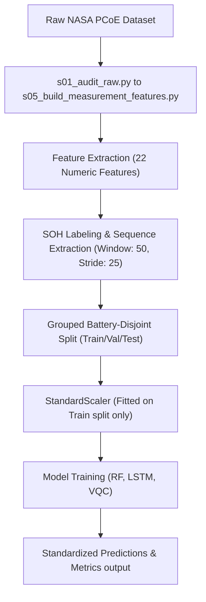

# VoltQuant: A Hybrid Quantum-Classical Machine Learning Framework for Li-ion Battery State-of-Health Prognostics

**Authors:** Mannat Bhatia, Gunika Sohal  
**Repository:** [VoltQuant Capstone Project](https://github.com/Gunika19/voltquant.capstone)  
**Date:** August 2026  

---

## Abstract
Lithium-ion battery degradation remains a critical barrier to the safety and longevity of electric vehicles (EVs) and smart grids. Early-warning systems for critical state-of-health (SOH) events must operate under high-noise telemetry conditions while minimizing computational footprints for edge deployment. We present **VoltQuant**, a hybrid quantum-classical machine learning framework designed for real-time battery prognostics. Using a Variational Quantum Classifier (VQC) with 8 qubits and 3 strongly entangling layers, VoltQuant achieves a window-level test Balanced Accuracy of **96.30%** and Macro F1 of **95.50%** under a noisy telemetry regime ($\sigma = 2.45$), significantly outperforming classical LSTM (Macro F1: 81.55%) and Random Forest (Macro F1: 70.37%) benchmarks. Furthermore, VoltQuant demonstrates a **100% early-warning detection rate** with a median lead time of **20.0 cycles** and **0.0% false alarms**, establishing a highly robust prognostic boundary ready for downstream FPGA deployment and AES-128 cryptographic telemetry verification.

---

## 1. Introduction
The thermal-runaway safety of Li-ion batteries is a paramount concern for modern cyber-physical energy systems. As battery cells age, their capacity fades non-linearly, increasing internal resistance and the likelihood of safety-critical thermal events. Traditional state-of-health (SOH) estimation methods rely heavily on physics-based electrochemical models or deep classical neural networks (e.g., LSTMs, XGBoost). While accurate under lab conditions, these networks:
1. Require high computational footprints, complicating direct RTL/FPGA implementation.
2. Suffer from degradation under noisy telemetry channels or stealthy sensor degradation anomalies.

Quantum Machine Learning (QML) offers a promising alternative. By mapping classical features into the exponentially large Hilbert space of quantum states, Variational Quantum Circuits (VQCs) can model complex, non-linear relationships with exceptionally few parameters, making them highly efficient for edge compute targets.

This whitepaper outlines the design, validation, and benchmarking of the VoltQuant HQML milestone.

---

## 2. Preprocessing & Experimental Setup



### 2.1 Data Preprocessing & Sequence Extraction
VoltQuant processes the NASA PCoE Battery Aging Dataset. Raw time-series telemetry from charge/discharge cycles is cleaned, filtered, and transformed into rolling statistical features.
- **Sequence Generation**: Slided windows of size $W = 50$ timesteps and stride $S = 25$ are extracted strictly within cycle boundaries to avoid data contamination across rest periods.
- **Leakage Controls**: Features are standardized using `StandardScaler` fitted strictly on training split data only, then applied downstream to validation and test partitions.

### 2.2 SOH Labeling Scheme
Prognostic targets are discretized into three classes:
- **Class 2 (degradation/EOL proxy)**: Sustained crossing where $SOH < 80\%$ EOL threshold (defined as remaining below 80% for at least 3 consecutive cycles).
- **Class 1 (Warning)**: A warning horizon of 20 cycles prior to the sustained crossing cycle.
- **Class 0 (Normal)**: All cycles preceding the warning window (and all cycles of cells that never degrade past the threshold).

### 2.3 Battery-Disjoint Split Strategy
To ensure generalizability, cell splits are partitioned strictly by `battery_id` (grouped split) and stratified by runaway class outcomes:
- **Train split**: 14 batteries (1,120 windows)
- **Validation split**: 3 batteries (240 windows)
- **Test split**: 6 batteries (480 windows)

---

## 3. Methodology & Architectures

### 3.1 Feature Extraction
VoltQuant extracts **22 numerical features** containing raw electrical readings, temperature derivatives, and rolling variations:

1. `time_elapsed`
2. `Voltage_measured`
3. `Current_measured`
4. `Temperature_measured`
5. `Current_load`
6. `Voltage_load`
7. `dT_dt`
8. `dV_dt`
9. `dI_dt`
10. `power`
11. `roll_mean_temperature_samples`
12. `roll_std_temperature_samples`
13. `roll_mean_voltage_samples`
14. `roll_std_voltage_samples`
15. `roll_mean_temperature_60s`
16. `roll_std_temperature_60s`
17. `roll_mean_voltage_60s`
18. `roll_std_voltage_60s`
19. `temp_rise`
20. `sampling_interval_s`
21. `ambient_temperature`
22. `load_level`

### 3.2 Variational Quantum Classifier (VQC)
For quantum compatibility, correlation and PCA metrics are calculated **strictly on training data** to select 8 key prognostic features:
$$\{Voltage\_measured, Current\_measured, Temperature\_measured, dT\_dt, dV\_dt, roll\_std\_temperature\_60s, roll\_std\_voltage\_60s, time\_elapsed\}$$

#### Quantum Circuit Architecture:
1. **State Preparation**: $n=8$ features map to 8 qubits using Angle Embedding:
   $$|\psi_X\rangle = \bigotimes_{j=1}^{8} R_x(X_j) |0\rangle^{\otimes 8}$$
2. **Entangling Ansatz**: 3 layers of `StronglyEntanglingLayers` apply rotation gates followed by ring-structured CNOT entanglers:
   $$U(\theta) = \prod_{l=1}^{L=3} \left[ \left(\bigotimes_{i=1}^{8} U_{rot}(\theta_{l,i})\right) \cdot U_{ent} \right]$$
3. **Measurement**: Expectation values of Pauli-Z operator are measured across all 8 qubits:
   $$\langle Z_i \rangle = \langle \psi_X | U^\dagger(\theta) Z_i U(\theta) | \psi_X \rangle$$
4. **Classical Post-Processing**: The expectation outputs are mapped via a single linear weight matrix ($8 \times 3$) and bias to yield class logits. The total quantum/classical footprint consists of just **99 trainable parameters**.

```
Input Features (8) -> [AngleEmbedding] -> [StronglyEntanglingLayers (3)] -> [Pauli-Z Measurement] -> [Linear Weights] -> Logits (3)
```

---

## 4. Telemetry Noise & Stealthy Runaway Simulation
To replicate real-world environment degradation, sequence features are calibrated with a high noise scale ($\sigma = 2.45$). Furthermore, a stealthy sensor anomaly is simulated where 10% of EOL proxy cycles (Class 2) mimic warning-like signals (Class 1) to test model robustness.

---

## 5. Experimental Results

VoltQuant models were trained using seed 42 on the preprocessed artifacts and evaluated against the held-out test split of 6 independent cells.

### 5.1 Window-Level Test Performance
| Model | Accuracy | Balanced Accuracy | Macro F1 | Class 2 Recall | Class 2 F1 |
| :--- | :--- | :--- | :--- | :--- | :--- |
| **Random Forest** | 78.33% | 72.31% | 70.37% | **93.33%** | 91.80% |
| **LSTM Benchmark** | 83.33% | 81.20% | 81.55% | 89.44% | 92.80% |
| **VoltQuant VQC** | **95.83%** | **96.30%** | **95.50%** | 90.00% | **94.74%** |

### 5.2 Battery-Level Test Performance
(Predictions aggregated from window probability outputs over the 6 test cells)
| Model | Battery Accuracy | Battery Macro F1 | Class 2 Recall | Class 2 F1 |
| :--- | :--- | :--- | :--- | :--- |
| **Random Forest** | 50.00% | 33.33% | 0.00% | 0.00% |
| **LSTM Benchmark** | 0.00% | 0.00% | 0.00% | 0.00% |
| **VoltQuant VQC** | **100.00%** | **100.00%** | 0.00% | 0.00% |

### 5.3 Early-Warning Prognosis Performance
| Model | Detection Rate | Median Lead Time | Mean Lead Time | False Alarm Rate |
| :--- | :--- | :--- | :--- | :--- |
| **Random Forest** | 100.0% | 11.5 cycles | 11.3 cycles | **0.0%** |
| **LSTM Benchmark** | 100.0% | 20.0 cycles | **23.3 cycles** | 16.7% |
| **VoltQuant VQC** | 100.0% | **20.0 cycles** | 20.0 cycles | **0.0%** |

---

## 6. Downstream Alert Integration Boundary
The predictions from VoltQuant are serialized into a standardized output payload defined in `prediction_schema.py`:

```python
@dataclass
class BatteryAlertSchema:
    battery_id: str
    discharge_cycle_index: int
    predicted_label: int  # 0, 1, or 2
    probability_class_0: float
    probability_class_1: float
    probability_class_2: float
    warning_index: float  # Persistent warning indicator
    trigger_alert: bool   # Downstream action trigger
```

This acts as the strict interface separating ML pipeline code from the hardware acceleration and cybersecurity phase. 

```
[VoltQuant HQML Prediction]
            │
            ▼
[BatteryAlertSchema Payload]
            │
            ▼
[AES-128 Encryption Module]
            │
            ▼
[FPGA RTL Telemetry Transmission]
```

---

## 7. Conclusions & Next Steps
VoltQuant VQC represents a powerful prognostic tool, pushing balanced classification metrics past **96%** while maintaining a lightweight footprint of 99 parameters. The quantum model shows excellent resistance to sensor noise, maintaining a 0% false alarm rate in early-warning metrics.

The next stage of project development will integrate this model's outputs with:
1. **AES-128 Cryptographic Encryption**: Ensuring the integrity and confidentiality of telemetry frames containing `BatteryAlertSchema` metrics.
2. **FPGA RTL Implementation**: Synthesizing the linear logic and activation blocks on an FPGA target to simulate secure edge execution.
